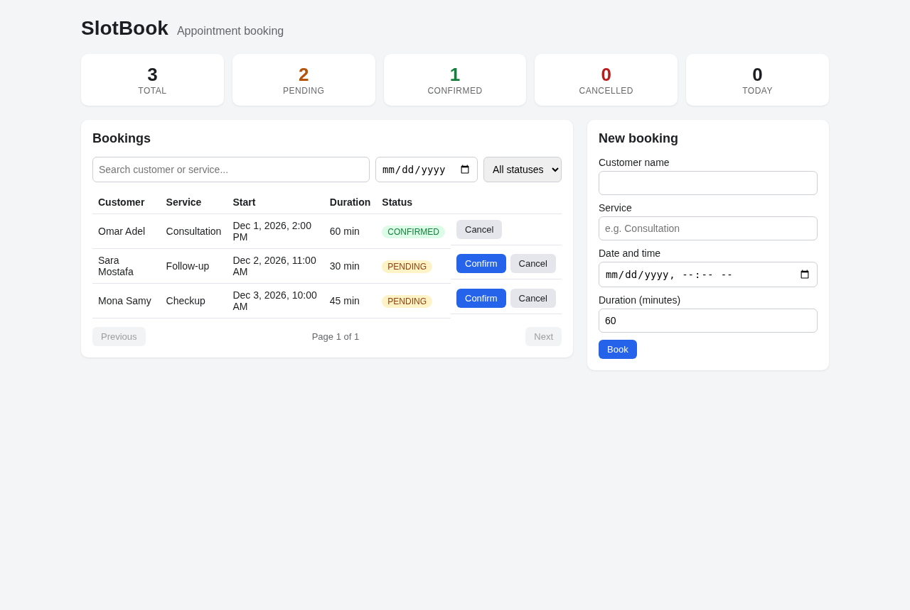
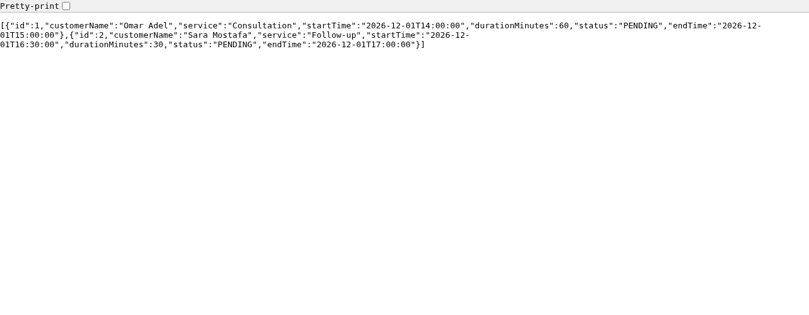

# SlotBook

A small appointment booking REST API, the kind a freelancer could adapt for
a clinic, tutor, barber or consultant.

You create bookings (customer name, service, start time, duration). The API
rejects bookings in the past and bookings that overlap an existing active
booking. Each booking has a status: PENDING -> CONFIRMED, or CANCELLED. A
cancelled slot can be booked again.

It also serves a small web UI at `/` (a single static page, no build step):
a bookings table with confirm/cancel buttons and a new-booking form that
calls the same API.

## Screenshots




The built-in web UI (a single static page, no build step) shows:

- Stats cards: total, pending, confirmed, cancelled, and today's bookings.
- Search by customer or service, filter by status, filter by day.
- A paginated bookings table with confirm/cancel actions.
- A new-booking form with clear validation messages (overlap, past date).

## Tech stack

- Java 11, Spring Boot 2.7 (Web, Data JPA, Validation)
- H2 in-memory database
- JUnit 5 + MockMvc tests

## API

| Method | Path | What it does |
|---|---|---|
| `GET` | `/api/bookings` | List bookings, with `status`, `q` (search), `date`, `page`, `size` |
| `GET` | `/api/bookings/stats` | Counts: total, pending, confirmed, cancelled, today |
| `POST` | `/api/bookings` | Create a booking (409 if it overlaps an active one, 400 if in the past) |
| `PATCH` | `/api/bookings/{id}/status` | Change status: `{"status": "CONFIRMED"}` |

Example create:

```json
POST /api/bookings
{
  "customerName": "Omar",
  "service": "Consultation",
  "startTime": "2026-12-01T14:00:00",
  "durationMinutes": 60
}
```

## How it works

- `Booking` is a JPA entity. `getEndTime()` derives the end from start +
  duration; `overlaps()` checks whether two bookings clash.
- On create, the controller loads all non-cancelled bookings and rejects the
  new one if any overlap it, so double-booking is impossible without locking
  tricks.
- Validation (`@NotBlank`, `@Future`, `@Min(15)`) keeps bad input out.
- Tests cover: creating, overlap rejection, reusing a cancelled slot,
  past-date rejection, search and status filters, the stats endpoint,
  listing, and bad status values.

## Run it

```bash
mvn spring-boot:run
# Web UI on http://localhost:8080/  (API under /api/bookings)
```

## Tests

```bash
mvn test
```
